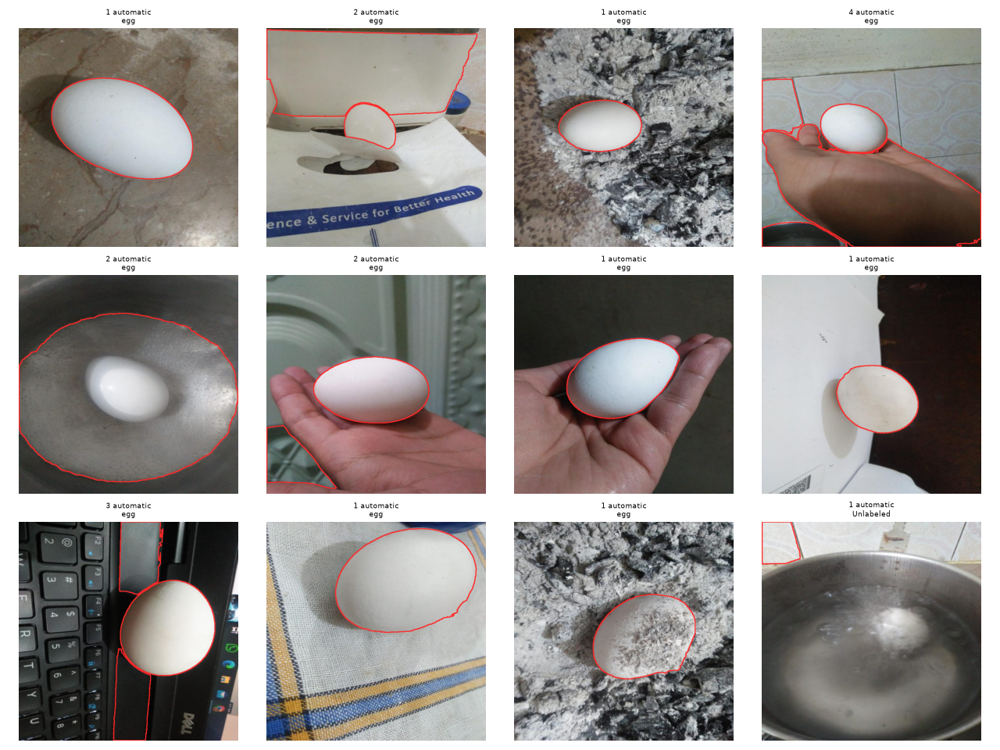
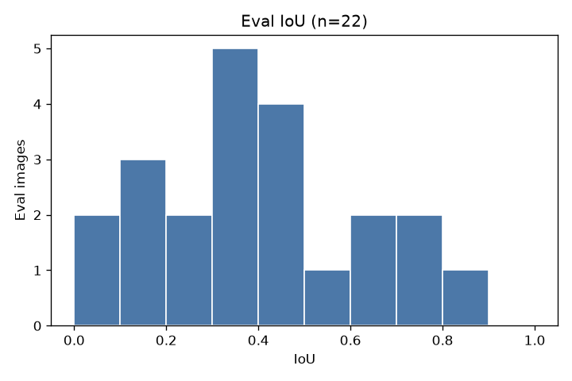
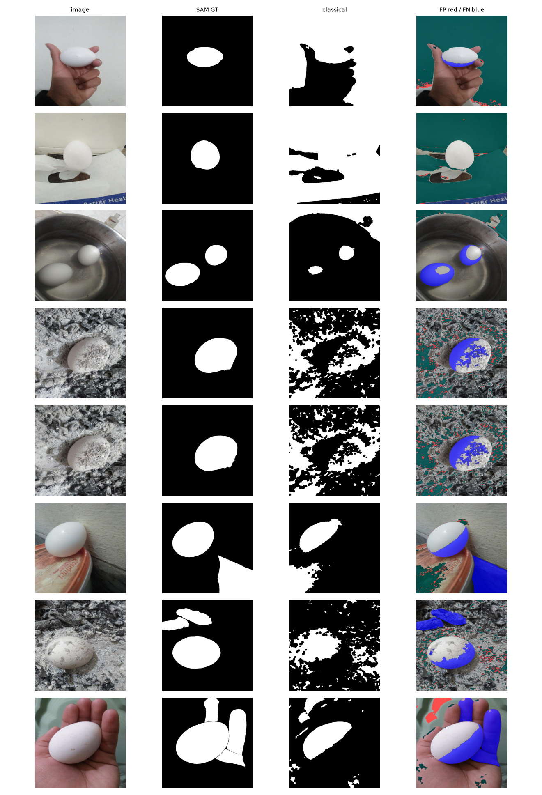
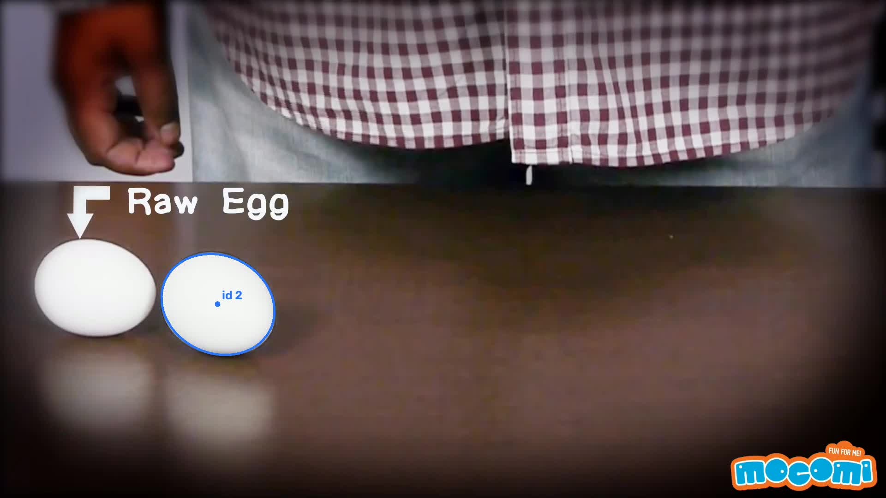
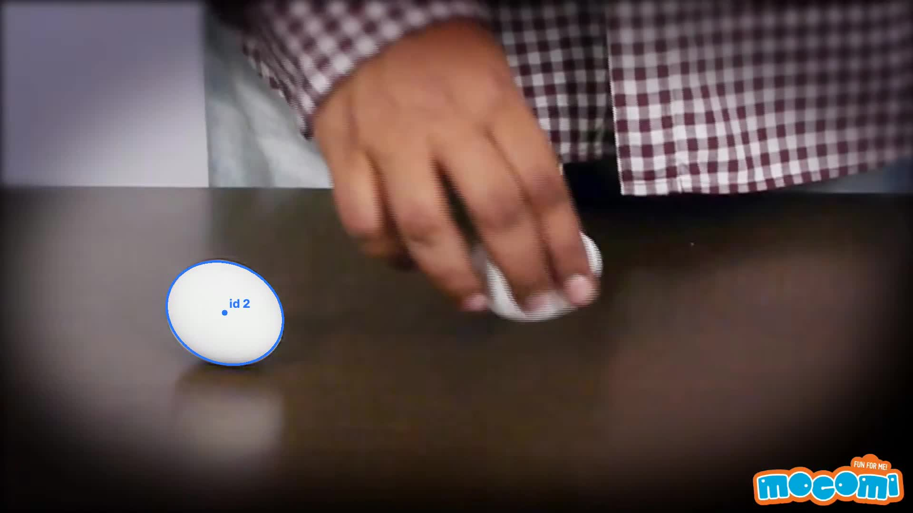
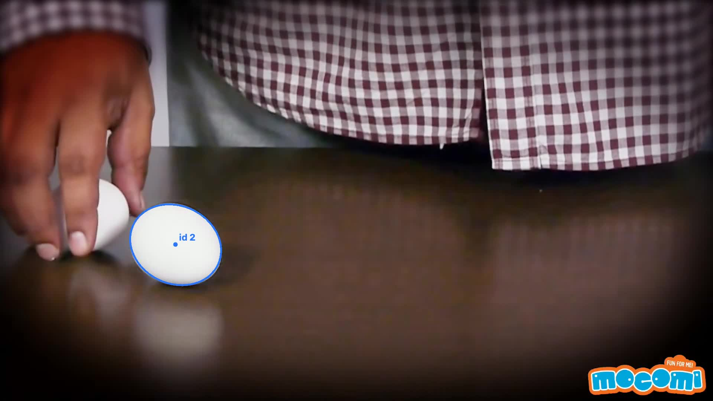
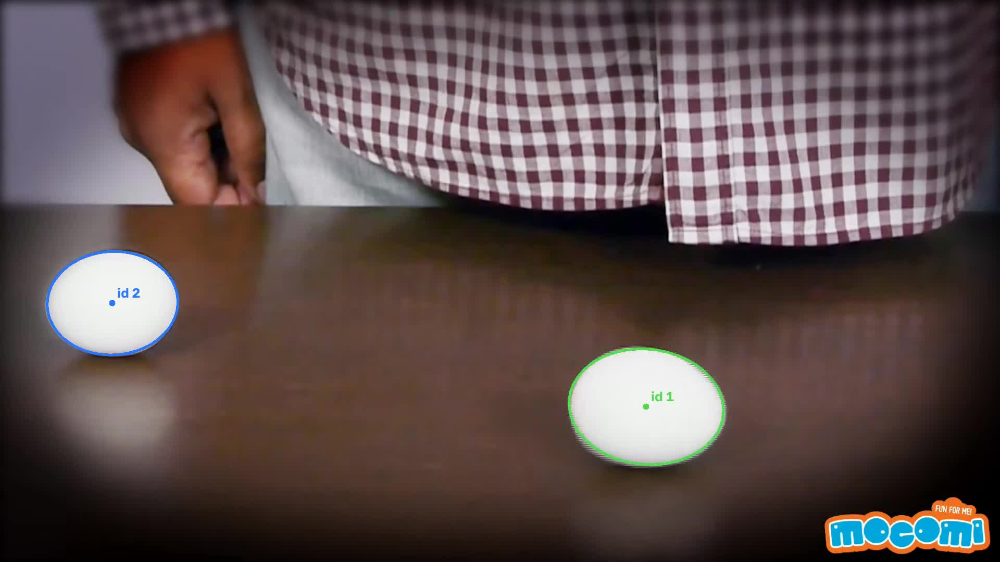

# Albumen

Classical egg segmentation and tracking. Code: https://github.com/Soham-47/albumen

This note covers a classical segmenter, SAM ViT-B pseudo masks, an eval split, and tracking on one 60 s clip. It stays light on maths. The only formulas used for scores are:

IoU = |P ∩ G| / |P ∪ G|

Dice = 2 |P ∩ G| / (|P| + |G|)

P is the classical mask. G is the SAM union mask. Both are semantic (one foreground), not instance, for Task 3.

## 1. Setup and how to run

Python 3.12.3. Torch 2.14.1+cpu. CUDA is not available on this machine (`nvidia-smi` reports a driver/library mismatch: kernel module 595.91 vs userspace 595.99). Every timed step below is CPU.

```bash
bash scripts/setup_env.sh
# download data (Drive id 1a58rACcCFnaj0ZiDoNyGbDWXunRyWziv) and SAM vit_b
bash scripts/run_all.sh
```

`scripts/run_all.sh` regenerates SAM masks (from cache if present), the classical masks from `configs/classical_final.yaml`, Task 3 figures, and the tracking videos. It does not retune the recipe.

Dataset on disk: 110 JPEGs, all 640×640, from the Drive zip. Folder counts: train/egg 75, train/Unlabeled 2, valid/egg 22, test/egg 11. No per-image boxes or masks shipped with the zip. The Roboflow readme says folder labels, stretch to 640×640, no augmentation, CC BY 4.0.

SAM checkpoint: `checkpoints/sam_vit_b_01ec64.pth` (358 MB). Mean SAM time on the cold pass: 46.1 s/image.

## 2. Task 1 — SAM pseudo ground truth

`src/task1_sam.py` runs `SamAutomaticMaskGenerator` (ViT-B, `points_per_side=16`, `pred_iou_thresh=0.86`, `stability_score_thresh=0.90`, `min_mask_region_area=400`). Raw proposals are cached under `outputs/sam_cache/`.

An egg proposal must pass all of these checks:

- Area fraction in [0.02, 0.55].
- Solidity at least 0.90.
- Fitted-ellipse aspect at most 3.2.
- Mask area over ellipse area in [0.75, 1.35].
- At most 35% of the border pixels inside the mask.
- Absolute HSV value gap vs the background at least 12, unless the interior is already white (V ≥ 165 and S ≤ 40).

Overlapping proposals merge at IoU 0.50. A larger mask that swallows a tighter one is dropped. If nothing survives, a colour-threshold box is sent to `SamPredictor`.

Measured result: 107 images automatic, 1 box fallback, 2 empty. Egg-count histogram: 0→2, 1→55, 2→24, 3→17, 4→8, 5→2, 7→2. The two Unlabeled images are flagged in `outputs/sam_masks/summary.csv`.



The other nine QA pages stay local under `outputs/sam_qa/` (gitignored). This page is committed so a clone still shows the overlay style.

## 3. Split and leakage

`src/split.py` groups images by perceptual hash (Hamming ≤ 8, seed 42) and puts whole groups into dev or eval at about 4:1.

- Dev: 87 images, 87 groups. Eval: 23 images, 22 groups. No shared path. No shared group id.
- The only pair inside Hamming 8 is inside eval and crosses the original Roboflow train/test folders (`not_damaged_27` and `not_damaged_78`). They were not split apart.
- Mean cross-cut Hamming distance is 30.941 over 2001 pairs. The minimum cross-cut distance is 16, which is above 8. The split was not changed after that check.

Scores later drop three images for SAM quality, not for leakage: `not_damaged_12` (empty SAM, egg under herbs), `not_damaged_39` (empty SAM, frame-cut on a printed lid), `not_damaged_145` (foam, not an egg). That leaves dev n=85 and eval n=22.

## 4. Task 2 — classical segmenter

No neural net. The function graders can edit live is `segment_eggs(bgr, cfg)` in `src/task2_classical.py`. The frozen config is T10.

Pipeline for T10:

1. Blur the BGR image with a 5×5 Gaussian.
2. Convert to HSV.
3. Keep pixels with saturation ≤ 60 and value ≥ 170 (white shell gate). Brown gate is off.
4. Morphological open with a 5×5 kernel, then close with an 11×11 kernel.
5. Write the mask as 0/255. No area cut, no circularity cut, no ellipse fill, no border drop, no hole fill.

Why this and not the longer plan recipe: those extras were tried and lowered dev mIoU. The log is `experiments/log.md`. Top of the table (dev, n=85, three exclusions already applied):

| Trial | Idea | mIoU | Dice | Empty rate | Keep? |
|---|---|---:|---:|---:|---|
| T01 | Gray Otsu | 0.346 | 0.468 | 0 | no, baseline |
| T02 | HSV white only | 0.381 | 0.502 | 0 | better than T01 |
| T03 | White OR brown | 0.317 | 0.438 | 0 | discard |
| T04 | Morphology on white+brown | 0.319 | 0.439 | 0 | discard |
| T05 | Area + circularity ≥ 0.45 | 0.199 | 0.239 | 0.553 | discard |
| T10 | White + morphology | 0.384 | 0.505 | 0 | **keep** |
| T11 | Area cut on T10 | 0.374 | 0.487 | 0.071 | discard |
| T12 | Loose circularity + ellipse | 0.345 | 0.447 | 0.129 | discard |
| T13 | Loose shape + border cut | 0.333 | 0.426 | 0.188 | discard |

T06–T09 stay in the log. They sit on the strict shape filter and score worse than T10. Brown was discarded because it pulled in wood, skin, and bags. Circularity ≥ 0.45 emptied more than half of dev. T10 is `configs/classical_final.yaml` and was not retuned after it was chosen.

## 5. Task 3 — metrics

Classical T10 versus SAM union masks. Population standard deviation. Primary number is eval.

| Split | n | mIoU | Dice | Precision | Recall |
|---|---:|---:|---:|---:|---:|
| Eval | 22 | 0.407 ± 0.214 | 0.546 ± 0.218 | 0.685 ± 0.332 | 0.559 ± 0.201 |
| Dev | 85 | 0.384 ± 0.263 | 0.505 ± 0.269 | 0.553 ± 0.357 | 0.620 ± 0.272 |

Size tertiles use GT area inside each split. Eval small / medium / large mIoU: 0.310 (n=8), 0.473 (n=7), 0.453 (n=7). Small eggs are the weak band.

Colour uses mean saturation inside the SAM mask (S < 40 is white, else brown). Eval brown has n=2 and is not reported as a stratum. Dev brown mIoU is 0.174 (n=11) against white 0.416 (n=74). That is the brown-shell miss: T10 has no brown gate.





Worst eval IoUs include `not_damaged_155` (0.079), `not_damaged_104` (0.094), and `not_damaged_113` (0.147). Notes:

- White clutter. Tables, paper, rice, and plastic pass the same S/V test as a white shell, so precision stays under recall on dev.
- Brown shells are mostly false negatives under T10.
- Touching eggs are not an IoU error by themselves, because Task 3 scores the union.
- Specular highlights can leave holes. Close-11 fills some of them.
- T10 has no min-area cut. Dark small eggs are missed when V is under 170, not because of an area filter.
- Some SAM masks include hands, keycaps, and white plastic. A classical miss on those pixels is not a missed egg.

## 6. Task 4 — video tracking

Source: `https://www.youtube.com/watch?v=Y4JyV94y2_A`, saved as `data/video/source.mp4`. 1920×1080, 24 fps, 60.0 s, 1440 frames. SAM was not run on the video.

Per frame: `segment_eggs` with T10, then connected components. Extra gates exist only in the tracker, not in the still-image config: area 8000–90000 px, circularity ≥ 0.70, box aspect ≥ 0.68, centroid y ≥ 0.48 of the frame height. Those cuts drop the shirt, the hand, and the logo, which the white gate also lights up.

Association is Hungarian matching on centroid distance and box IoU. Max match distance is 1400 px, wide enough for the egg to be set down across the table. A Kalman filter predicts the centroid while the egg is visible. While it is hidden, the track stays at the last position instead of coasting off in a straight line. A track can live 720 frames (30 s) without a detection. Drawn outlines are fitted ellipses.

On this clip: 2 track ids, never more than 2 eggs in one frame, detections on 757 frames (mean 1.65 eggs when a detection exists). Id 2 stays on the egg that is not spun. Id 1 is the egg that is picked up and set down on the right. The left egg is missed while the “Raw Egg” caption covers it, because the blob is no longer round enough.

**Full video Drive link:** DRIVE_URL_PLACEHOLDER — Soham must upload `video/tracked_full.mp4` and paste the link. The file is local (about 9.4 MB) at `video/tracked_full.mp4`. A 30 s preview is `video/tracked_preview.mp4`. The upload did not fit the Drive API size limit used in this environment.

Frames 334, 523, 712, and 926:






## 7. AI disclosure

See `DISCLOSURE.md` in the repo root. Short version: Grok drafted the plan and the code. Masks, metrics, and track counts were measured by running that code. No network was trained.

## 8. Limitations

- Brown eggs are weak. Adding a brown HSV gate hurt dev mIoU because it also took wood and skin. A better split would need a tighter colour model or a shape prior that does not empty the set.
- SAM is noisy ground truth. Hands, keycaps, foam, and two empty masks are still in the raw outputs. Three of those images are excluded from the headline scores, and the rest still bias IoU.
- The two eggs keep id 1 and id 2 across the move. A detection is still dropped while the “Raw Egg” caption covers the left egg, because the blob fails the circularity gate.
- The stills are 640×640 table crops. The video is a different scene. The white gate fires on bright backgrounds there, which is why the tracker adds gates the still-image config does not have.
- The full tracked video is not shared on Drive yet. The placeholder above is intentional.
